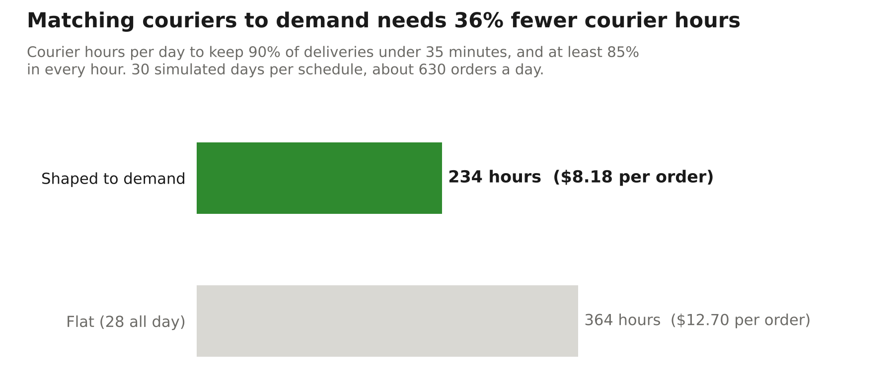
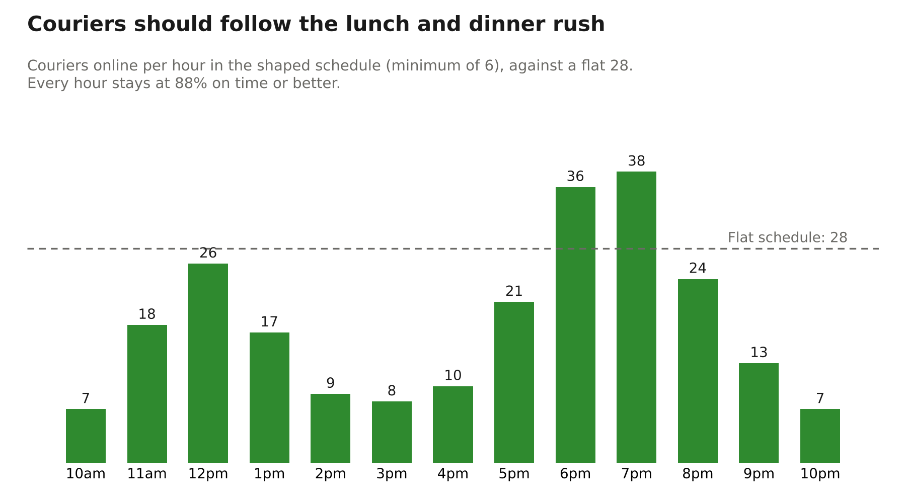

# Marketplace Supply Simulation: How Many Couriers Does a New City Need?

A discrete-event simulation of a food delivery marketplace in a new launch city, built in **SimPy**, with every simulated order stored in **DuckDB** and analysed in **SQL**. It finds the smallest courier schedule that still delivers on time, hour by hour.

## The question

A new city gets about 630 orders a day, with a lunch peak around noon and a bigger dinner peak at 6pm to 7pm. Couriers are paid for every hour they are online.

**How many couriers should be online each hour so that 90% of deliveries arrive within 35 minutes, without paying for idle time?**

## The recommendation

**Schedule couriers to match the demand curve, with a minimum of 6 online at all times.** That hits the service target with **234 courier hours a day instead of 364 for a flat schedule: 36% fewer.** Courier cost per order falls from $12.70 to $8.18, and service gets slightly better (92.9% on time against 92.2%).

At an assumed $22 per courier hour, that is about $2,900 a day, or roughly $1M a year, for one mid-sized city.

| Schedule | Courier hours a day | On time (day) | On time (worst hour) | 90th percentile delivery | Orders per courier hour | Courier cost per order |
|---|---|---|---|---|---|---|
| Flat, 28 couriers all day | 364 | 92.2% | 86.4% (7pm) | 33.6 min | 1.73 | $12.70 |
| **Shaped to demand** | **234** | **92.9%** | **88.5% (2pm)** | **33.1 min** | **2.69** | **$8.18** |

Both are the cheapest schedule of their type that meets the target: at least 90% of orders on time across the day **and** at least 85% in every hour.

## Charts





The flat schedule wastes money and still struggles. At 3pm, 28 couriers share about 20 orders. At 7pm, the same 28 face about 104 orders, and that hour drops to 86% on time.

## Why the hourly floor matters

A daily average can hide a bad hour. The shaped schedule one step cheaper (214 hours) reaches 91.7% on time across the day, which looks fine, but its weakest hour falls to 81%. Customers who order in that hour have a poor experience, and early in a launch that is when you lose them. That is why the target includes **at least 85% in every hour**, and why the schedule keeps **at least 6 couriers online** even when demand is low: with only a few couriers, one long delivery leaves the next customer waiting.

## How the simulation works

Each simulated day runs from 10am to 11pm ([`sim/model.py`](sim/model.py)):

1. **Orders arrive** at random (a Poisson process) at the rate set by the hourly demand curve
2. **The restaurant starts cooking** straight away (preparation averages 12 minutes)
3. **The order waits for a free courier**, first come, first served
4. **The courier travels to the restaurant** (averages 6 minutes) and waits if the food is not ready
5. **The courier delivers** (averages 9 minutes) and is then free for the next order from that location
6. **Courier supply follows the hourly schedule.** When the schedule steps down, couriers finish their current delivery before going offline

Travel and preparation times are random (gamma distributions), so every simulated day is different. Each schedule runs for 30 simulated days. In total the experiment simulates about 380,000 orders across 20 schedules ([`scripts/run_experiments.py`](scripts/run_experiments.py)).

**Schedules tested**
- **Flat:** 20 to 40 couriers online every hour
- **Shaped:** couriers each hour = the larger of 6 and (K × expected orders that hour), for K from 0.24 to 0.48

## The SQL analysis

All results come from SQL over the simulated order table ([`sql/`](sql)):

- [`01_scenario_summary.sql`](sql/01_scenario_summary.sql): on-time rate, worst hour, delivery-time percentiles, courier hours and cost per order for every schedule
- [`02_cheapest_plan.sql`](sql/02_cheapest_plan.sql): the cheapest schedule of each type that meets the target (`QUALIFY ROW_NUMBER() OVER (PARTITION BY plan_type ...)`)
- [`03_hourly_view.sql`](sql/03_hourly_view.sql): hour-by-hour service for the winning schedules, and each one's worst hour

## Repository structure

```
sim/model.py                 SimPy model of orders, restaurants and couriers
scripts/
  run_experiments.py         run 20 schedules x 30 days, store orders in DuckDB
  analyze.py                 run the SQL and export results/
  make_charts.py             README charts
sql/                         analysis queries
results/                     scenario summary, cheapest plans, hourly service
charts/                      README charts
```

## How to run it

```bash
pip install simpy duckdb pandas matplotlib
python scripts/run_experiments.py   # about a minute
python scripts/analyze.py
python scripts/make_charts.py
```

## Limitations and next steps

- **One zone, no geography.** Real cities have zones with different travel times. Next step: split the city into zones and let couriers reposition
- **No batching.** Couriers carry one order at a time. Stacking two orders from the same restaurant would raise orders per courier hour further
- **Couriers appear on schedule.** In reality courier supply responds to pay and incentives. Next step: model peak-pay incentives as the lever for getting couriers online at 6pm to 7pm
- **Demand is known in advance.** Real demand varies with weather and promotions. Next step: test the schedule against demand 15% above and below plan
- **Cost assumption.** $22 per courier hour is illustrative; the comparison between schedules holds at any hourly rate

## Licence

MIT. All data is generated by the simulation.
