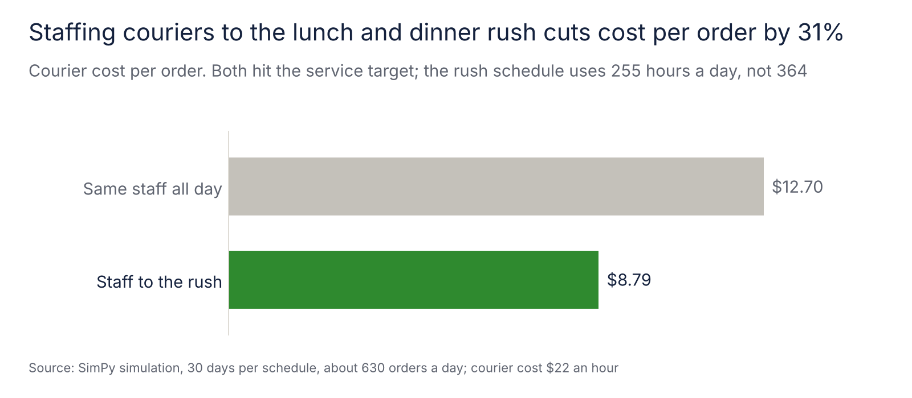
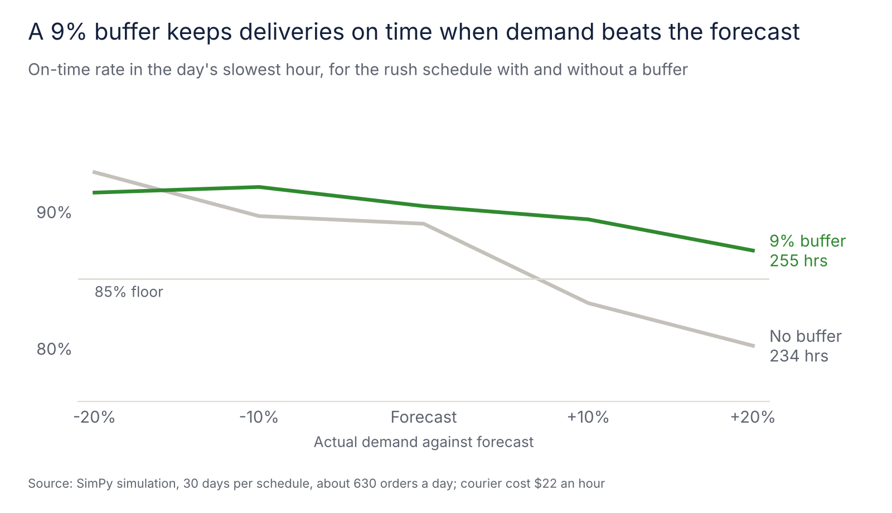
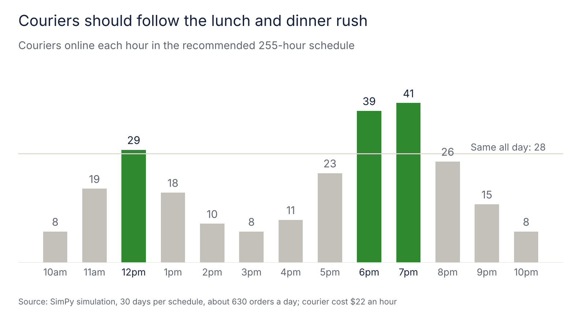

# Marketplace Supply Simulation: How Many Couriers Does a New City Need?

A discrete-event simulation of a food delivery marketplace in a new launch city, built in **SimPy**, with every simulated order stored in **DuckDB** and analysed in **SQL**. It finds the courier schedule that delivers on time at the lowest cost, what extra service is worth paying for, and how much buffer protects a launch when the demand forecast is wrong.

## The question

A new city is forecast to get about 630 orders a day, with a lunch peak around noon and a bigger dinner peak at 6pm to 7pm. Couriers are paid for every hour they are online. In a new city, the forecast is a guess.

**How many couriers should be online each hour so that 90% of deliveries arrive within 35 minutes (and at least 85% in every hour), and how much buffer should the plan carry in case demand comes in higher than forecast?**

## The recommendation

Two ways to schedule couriers are compared. A **flat** schedule keeps the same number of couriers online all day. A **shaped** schedule follows demand: more couriers at the lunch and dinner rush, fewer in quiet hours. Orders bunch up at mealtimes, so a flat schedule has to be big enough for the dinner peak and then pays couriers to wait around the rest of the day.

**Schedule couriers to the demand curve, and plan on 255 courier hours a day: one step above the cheapest schedule that meets the target.**

1. **Shape the schedule to demand.** It meets the target with 30% fewer courier hours than a flat schedule (255 against 364). That is about **$875,000 a year** for one mid-sized city at $22 per courier hour, and courier cost per order falls from $12.70 to $8.79
2. **Carry a 9% buffer.** The cheapest shaped schedule (234 hours) only works if the forecast is right: when demand runs 10% high, its worst hour drops to 83% on time, below the 85% floor. The 255-hour schedule holds the target from 20% below forecast to 20% above. The buffer costs about $169,000 a year, a small price for protecting the first months of a launch
3. **Don't pay for more than about 93% on time.** Service levels off: going from 234 to 292 hours a day (about $466,000 a year) buys 1.2 more points (92.9% to 94.1%). Spend that money on demand instead
4. **Re-plan from real data after the first weeks.** Once actual orders replace the forecast, the buffer can shrink

**What would change the answer:** a tighter delivery promise than 35 minutes, longer travel times (a more spread-out city), or a forecast that is badly wrong in one direction, such as a launch promotion that doubles demand.

## Charts







## Results

### Cheapest schedule of each type that meets the target (at forecast demand)

| Schedule | Courier hours a day | On time (day) | On time (worst hour) | 90th percentile delivery | Courier cost per order |
|---|---|---|---|---|---|
| Flat, 28 couriers all day | 364 | 92.2% | 86.4% (7pm) | 33.6 min | $12.70 |
| Shaped to demand, minimum | 234 | 92.9% | 88.5% (2pm) | 33.1 min | $8.18 |
| **Shaped to demand, with buffer (recommended)** | **255** | **93.4%** | **91.4%** | **32.9 min** | **$8.79** |

### Forecast stress test: worst-hour on-time rate when demand misses the forecast

| Schedule | Courier hours | Demand -20% | -10% | Forecast | +10% | +20% |
|---|---|---|---|---|---|---|
| Shaped, minimum | 234 | 92.8% | 89.6% | 89.0% | **83.2%** | **80.1%** |
| **Shaped, with buffer** | **255** | 91.3% | 91.7% | 90.3% | 89.3% | 87.1% |
| Shaped, two steps up | 274 | 91.5% | 91.8% | 92.5% | 87.3% | 87.6% |

Bold = below the 85% floor. Each cell is 30 simulated days; the stress test uses its own random days, so its at-forecast figures differ slightly from the table above. Full results, including day-level on-time and cost per order: [`results/forecast_stress_test.csv`](results/forecast_stress_test.csv)

The buffered schedule also feeds the companion [market entry investment case](https://github.com/ekene-ok/market-entry-investment-case), where courier cost of $9 per order or less is what makes Halifax pay back. At $8.79 per order with the buffer, it still clears that bar.

## Why the hourly floor matters

A daily average can hide a bad hour. The shaped schedule one step cheaper (214 hours) reaches 91.7% on time across the day, which looks fine, but its weakest hour falls to 81%. Customers who order in that hour have a poor experience, and early in a launch that is when you lose them. That is why the target includes **at least 85% in every hour**, and why the schedule keeps **at least 6 couriers online** even when demand is low: with only a few couriers, one long delivery leaves the next customer waiting.

## How the simulation works

Each simulated day runs from 10am to 11pm ([`sim/model.py`](sim/model.py)):

1. **Orders arrive** at random (a Poisson process) at the rate set by the hourly demand curve
2. **The restaurant starts cooking** straight away (preparation averages 12 minutes)
3. **The order waits for a free courier**, first come, first served
4. **The courier travels to the restaurant** (averages 6 minutes) and waits if the food is not ready
5. **The courier delivers** (averages 9 minutes) and is then free for the next order from that location
6. **Courier supply follows the hourly schedule.** When the schedule steps down, couriers finish their current delivery before going offline

Travel and preparation times are random (gamma distributions), so every simulated day is different. Each schedule runs for 30 simulated days. In total the experiment simulates about 380,000 orders across 20 schedules ([`scripts/run_experiments.py`](scripts/run_experiments.py)).

**Schedules tested**
- **Flat:** 20 to 40 couriers online every hour
- **Shaped:** couriers each hour = the larger of 6 and (K × expected orders that hour), for K from 0.24 to 0.48

## The SQL analysis

All results come from SQL over the simulated order table ([`sql/`](sql)):

- [`01_scenario_summary.sql`](sql/01_scenario_summary.sql): on-time rate, worst hour, delivery-time percentiles, courier hours and cost per order for every schedule
- [`02_cheapest_plan.sql`](sql/02_cheapest_plan.sql): the cheapest schedule of each type that meets the target (`QUALIFY ROW_NUMBER() OVER (PARTITION BY plan_type ...)`)
- [`03_hourly_view.sql`](sql/03_hourly_view.sql): hour-by-hour service for the winning schedules, and each one's worst hour
- [`04_forecast_stress.sql`](sql/04_forecast_stress.sql): service and cost for each schedule when demand runs 20% below to 20% above forecast

## Repository structure

```
sim/model.py                 SimPy model of orders, restaurants and couriers
scripts/
  run_experiments.py         run 20 schedules x 30 days, store orders in DuckDB
  stress_test.py             run 4 schedules at 5 demand levels x 30 days
  analyze.py                 run the SQL and export results/
  make_charts.py             README charts
  brand_style.py             shared chart style
sql/                         analysis queries
results/                     scenario summary, cheapest plans, hourly service
charts/                      README charts
```

## How to run it

```bash
pip install simpy duckdb pandas matplotlib
python scripts/run_experiments.py   # about a minute
python scripts/stress_test.py
python scripts/analyze.py
python scripts/make_charts.py
```

## Limitations and next steps

- **One zone, no geography.** Real cities have zones with different travel times. Next step: split the city into zones and let couriers reposition
- **No batching.** Couriers carry one order at a time. Stacking two orders from the same restaurant would raise orders per courier hour further
- **Couriers appear on schedule.** In reality courier supply responds to pay and incentives. Next step: model peak-pay incentives as the lever for getting couriers online at 6pm to 7pm
- **Demand is known in advance.** Real demand varies with weather and promotions. Next step: test the schedule against demand 15% above and below plan
- **Cost assumption.** $22 per courier hour is illustrative; the comparison between schedules holds at any hourly rate

## Licence

MIT. All data is generated by the simulation.
